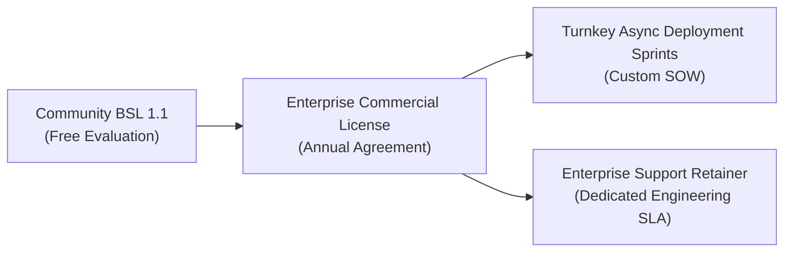

# Enterprise Commercial Licensing & Professional Services

**Vendor**: Liam D Gray Labs  
**Product**: `procore-mcp` (Enterprise Model Context Protocol Server for Procore Construction Management)  
**Governance Model**: Business Source License 1.1 (BSL 1.1) with Enterprise Commercial Exception & Master Services Agreement (DMSA/MSA)  
**Contact**: `procurement@liamdgray.com` | `security@liamdgray.com`

---

## 1. Executive Summary & Licensing Framework

Commercial construction operations carry irreversible legal, contractual, and financial risk. `procore-mcp` is engineered specifically to eliminate these liabilities by enforcing mathematical safety invariants and payload distillation between autonomous AI agents (such as Claude Desktop, Claude Code, and agentic LLM pipelines) and Procore REST APIs.

To balance open research evaluation with sustainable enterprise-grade software maintenance, `procore-mcp` operates under a dual-tier licensing model:

### Business Source License 1.1 (BSL 1.1) vs. Enterprise Commercial License

| Dimension | Community Edition (BSL 1.1) | Enterprise Commercial License |
|:---|:---|:---|
| **Target Audience** | Open-source evaluators, researchers, internal staging | General Contractors (ENR 400), Subcontractors, ConTech SaaS |
| **Permitted Environments** | Local workstations, development, non-production testing | Production cloud VPCs, automated production pipelines, client-facing deployments |
| **Pricing** | **Free ($0)** | **Annual Agreement** (Tiered by active project volume & construction scale) |
| **Legal Indemnity** | None (AS-IS, disclaimer of warranty) | **Full IP & Safety Invariant Indemnification** |
| **Multi-Tenant DMSA** | Single-tenant developer testing | **Multi-tenant DMSA credentials & enterprise token management** |
| **Support SLA** | Best-effort GitHub community issues | **Guaranteed 24-to-48-hour async SLA** |
| **Open Source Sunset** | Automatically transitions to Apache 2.0 on October 4, 2028 | Perpetual commercial rights regardless of sunset |

---

## 2. Commercial Licensing Tiers & Engagement Packages

Liam D Gray Labs provides three enterprise engagement tiers tailored for corporate IT procurement, construction VDC/BIM leaders, and field operations technology directors.

### Tier 1: Enterprise Commercial License
* **Pricing**: Annual Enterprise Agreement (Tiered based on active project volume, business units, and organizational scale. Contact `procurement@liamdgray.com`).
* **Scope**:
  - Full production deployment rights across unlimited internal agent seats, developer workstations, and background runner instances.
  - Multi-tenant Developer Managed Service Account (DMSA) credential provisioning and automated lifecycle management.
  - Commercial legal indemnity and intellectual property non-infringement warranty.
  - Inclusion in the Enterprise Security Advisory broadcast (advance CVE notices and zero-day patch alerts).
  - Production compliance certification for SOC 2 Type II and ISO 27001 auditor review.

### Tier 2: Turnkey Async Deployment Sprints
* **Pricing**: Fixed-Scope Statement of Work (SOW scoped upon technical discovery).
* **Delivery Timeline**: 2 to 4 weeks, executed 100% asynchronously via private Git repository, structured RFCs, and automated verification suites.
* **Scope & Deliverables**:
  - **Cloud Infrastructure Deployment**: Hardened deployment on client VPC (AWS ECS/Fargate, Google Cloud Run, Azure Container Apps, or Kubernetes).
  - **Procore Marketplace Integration**: Custom DMSA app registration, permission template scoping, and environment variable hardening.
  - **Enterprise ERP Cost-Code Alignment**: Tailored mapping for CSI MasterFormat, custom WBS tiers, and financial cost-code schemas.
  - **Claude Desktop & Claude Code Configuration**: Distribution-ready configuration profiles and developer onboarding packages.
  - **Automated End-to-End Acceptance Tests**: Pytest test suites validating zero-leak credentials, draft-only mutations, and audit log generation against client Procore sandbox environments.

### Tier 3: Enterprise Support Retainer
* **Pricing**: Tailored Ongoing SLA Retainer (Billed quarterly or annually).
* **Scope**:
  - Guaranteed 24-to-48-hour asynchronous response SLA for engineering tickets, API changes, and breaking Procore REST schema migrations.
  - Monthly proactive dependency updates, security vulnerability remediation, and token distillation efficiency tuning.
  - Custom tool development: Up to 2 bespoke Procore endpoint integrations per quarter (e.g., custom punch list workflows, prime contract change orders, or specialty inspection modules).
  - Direct async architectural guidance on autonomous agent workflow orchestration.

---

## 3. Multi-Tenant DMSA Credential Architecture

Enterprise deployments frequently require managing multiple Procore Company IDs across distinct joint-venture entities, operating divisions, or subsidiaries. 

Under the Enterprise Commercial License:
1. **Isolated Keyrings**: Credentials for each enterprise tenant are isolated in memory and passed via secure environment references or encrypted cloud secrets managers (AWS Secrets Manager, GCP Secret Manager, HashiCorp Vault).
2. **Autonomous Token Refresh**: The `ProcoreDMSAAuth` engine proactively rotates Bearer tokens inside a 300-second expiration buffer without requiring user interaction or browser popups.
3. **Audit Hash Integrity**: Every REST transaction executed across tenants is recorded with client-specific HMAC-SHA256 signatures, preventing cross-tenant ledger corruption.

---

## 4. Legal Protections, Warranties & Commercial Indemnification

Enterprises deploying AI agents into construction management face substantial financial exposure. Commercial licensing agreements with Liam D Gray Labs include robust contractual protections:

### 1. Intellectual Property Indemnification
Liam D Gray Labs defends and indemnifies the licensee against any third-party claims alleging that `procore-mcp` infringes upon any copyright, trade secret, or United States patent, subject to standard enterprise defense procedures and aggregate liability provisions.

### 2. The Zero Unauthorized Commitment Guarantee
Liam D Gray Labs warrants that the server's deterministic safety gates (`assert_write_permitted`) mathematically prevent an AI agent from transitioning any Procore RFI, Commitment, Change Event, or Submittal into binding or authoritative statuses (`issued`, `approved`, `executed`, `closed`). All mutating operations are restricted to `draft` status, requiring human physical sign-off in the Procore Web UI.

### 3. Data Privacy & Zero-Leak Assurance
Liam D Gray Labs warrants that `procore-mcp` operates completely self-contained within your infrastructure:
- **Zero Third-Party Telemetry**: No telemetry, analytics, or logging payloads are transmitted to Liam D Gray Labs or external servers.
- **Zero Prompt Secret Injection**: Client IDs, Client Secrets, and Bearer Tokens are strictly isolated from LLM context streams.

---

## 5. Master Services Agreement (MSA) & Procurement Process

We accommodate Fortune 500 and ENR 400 vendor onboarding processes with minimal administrative friction:

1. **Vendor Paperwork**: Standard W-9, Certificate of Insurance (COI) with Errors & Omissions / Cyber Liability, and vendor registration forms provided within 24 business hours.
2. **Payment Methods**: ACH direct deposit, wire transfer, corporate credit card, or Net-30 purchase orders upon credit verification.
3. **Paper Contracts & Redlines**: We accept client MSA/DMSA templates on Turnkey Deployment Sprint engagements and Enterprise Licenses over $10,000.

### Procurement Contact
To initiate vendor onboarding, request an Enterprise License invoice, or schedule a Turnkey Async Deployment Sprint:
* **Procurement Email**: `procurement@liamdgray.com`
* **Executive Engineering Office**: `liam@liamdgray.com`
* **Security & Vulnerability Office**: `security@liamdgray.com`
* **Entity**: Liam D Gray Labs (Operating in California, United States)
